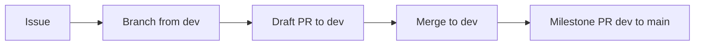

# Development Workflow

## Branches
| Branch | Role |
|--------|------|
| `main` | Stable; receives merges from `dev` after several milestones |
| `dev` | Integration; every PR targets it |
| `<type>/<issue#>-<slug>` | Work branches, cut from `dev` |

Types: `lab`, `feat`, `fix`, `docs`, `chore`.

## For every feature, modification, or fix
1. **Open an issue** describing the change.
2. **Create a branch from `dev`**: `git switch -c lab/5-hpc-pocket-cluster dev`.
3. **Open a draft PR into `dev`** with `Closes #<issue>`.
4. Commit, update `docs/` (and `README.md` if user-facing) in the same PR.
5. Mark the PR ready and merge into `dev`.
6. At a milestone, open a PR from `dev` to `main`.

## Commits
- Use your GitHub noreply email if email privacy is enabled (otherwise pushes are rejected).
- Never force-push shared branches (`main`, `dev`).
